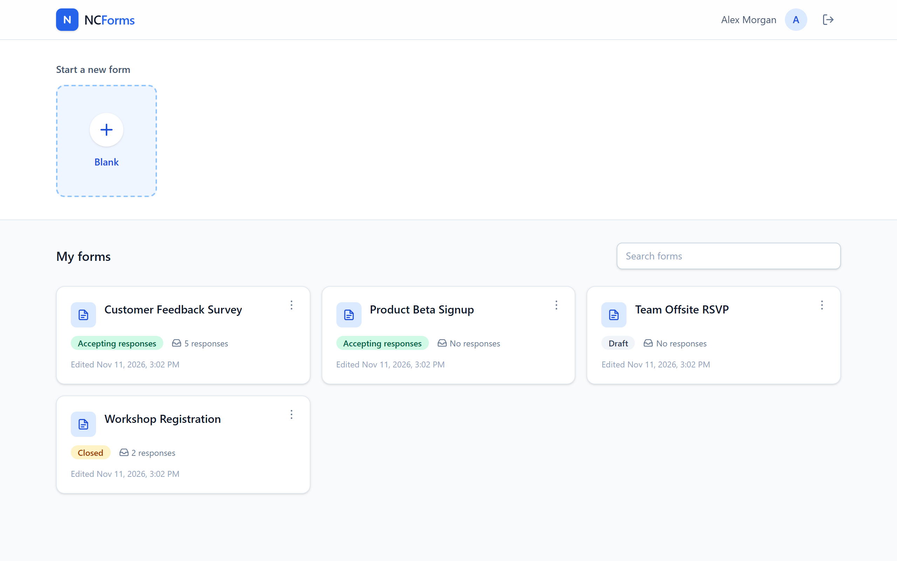
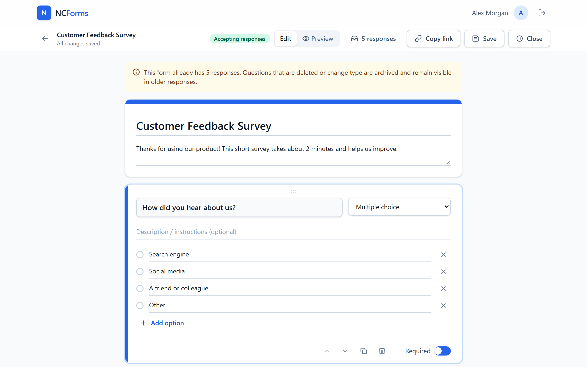
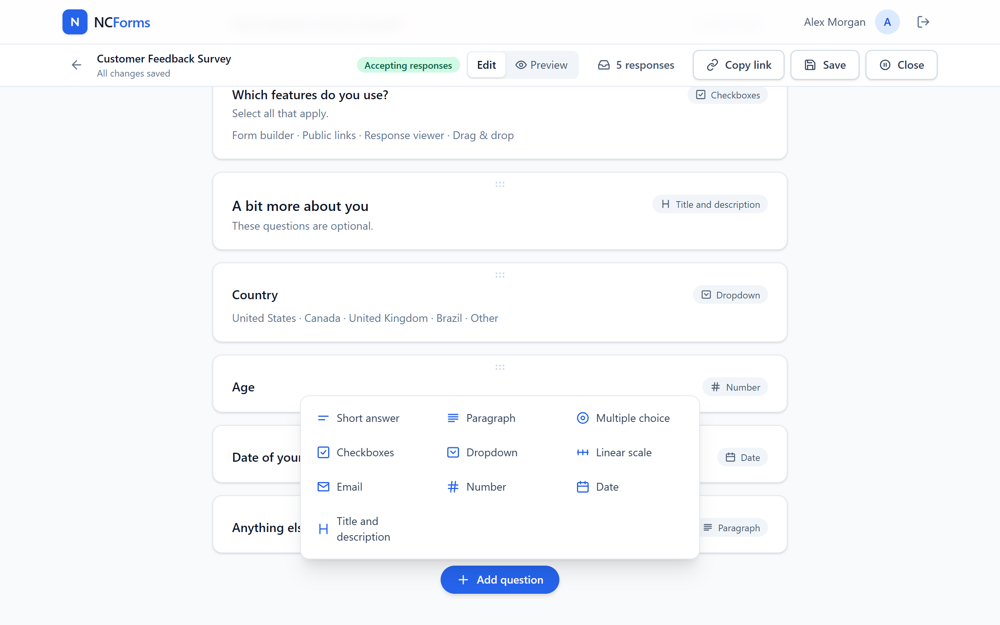
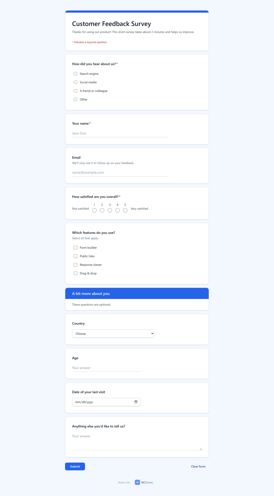
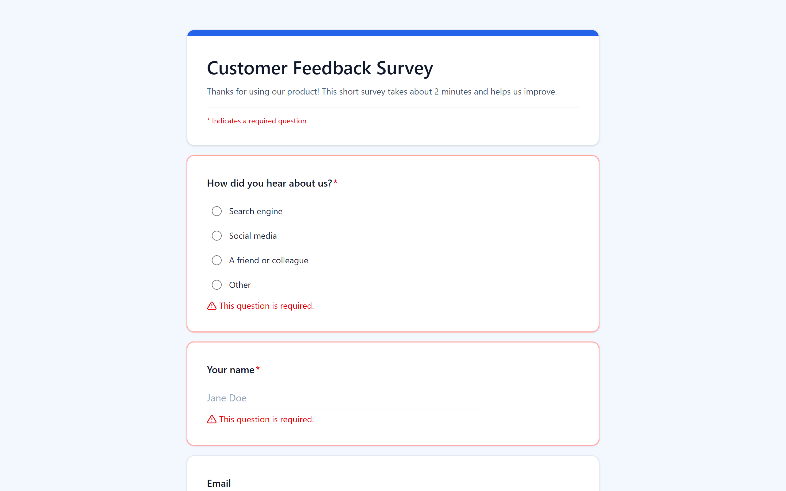
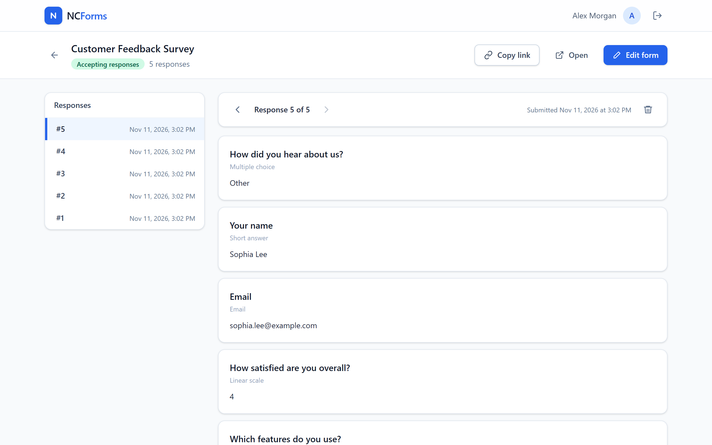
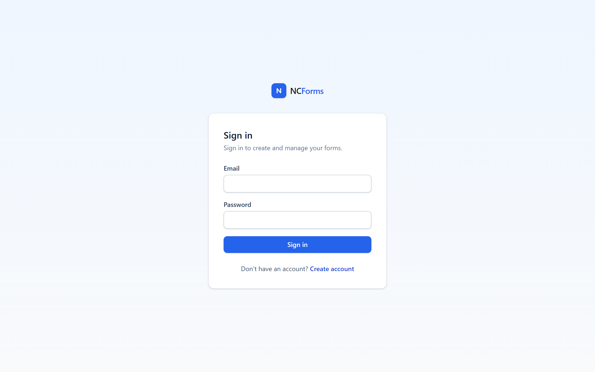

# NCForms

A self-hosted Google Forms alternative: build forms with many question types, share them through a public link and review the responses one by one.

- **Frontend:** Angular 21 (standalone + signals) + Tailwind CSS 4
- **Backend:** Spring Boot 4.1 (Java 17) + Spring Security (JWT) + Spring Data JPA + Flyway
- **Database:** PostgreSQL 16
- **Deployment:** Docker Compose (Postgres + API + Nginx serving the Angular app and proxying `/api`), with an optional Caddy overlay for HTTPS

## Features

- Creator accounts (email and password sign-in); each user only sees their own forms.
- Home screen with a new-form button and a list of all forms (status, response count, search).
- Editor with title/description and unlimited fields, reorderable by drag and drop:
  short answer, paragraph, multiple choice, checkboxes, dropdown, linear scale,
  email, number, date and section titles. Any question can be **required**.
- Per-type settings: placeholder text, character limit, numeric min/max,
  min/max selections, scale range and labels.
- Preview identical to what respondents will see.
- Publishing with a public link `/f/{code}` (no sign-in needed to answer); a form can be closed and reopened.
- Validation in the browser **and** on the server (required fields, formats, limits).
- Results: response list and individual view with previous/next navigation.
- Editing a form that already has responses never loses data: removed questions/options are archived
  and keep showing up in older responses.

## Screenshots

**My forms** — create a blank form, search and manage every form with its status and response count.



**Form editor** — edit the title, description and questions inline; the selected question shows its
type, options, reorder/duplicate/delete actions and the *Required* toggle.



**Question types** — short answer, paragraph, multiple choice, checkboxes, dropdown, linear scale,
email, number, date and section titles.



**Public form** — what respondents see at `/f/{code}`, no sign-in required. Validation runs in the
browser and again on the server.

<table>
  <tr>
    <td width="50%" valign="top"></td>
    <td width="50%" valign="top"></td>
  </tr>
</table>

**Responses** — browse responses one by one, with previous/next navigation and deletion.



**Sign in** — creator accounts with email and password.



## Deploying to a VPS (recommended)

NCForms needs a server: the API (Spring Boot) and the database (Postgres) must run somewhere.
Static hosts such as GitHub Pages only serve HTML/JS/CSS files, so they can't run it.
The simplest setup is a small VPS running the whole stack with Docker Compose, with Caddy in front
for automatic HTTPS.

**Prerequisites**

- A Linux VPS with Docker and the Docker Compose plugin (v2.24+).
- A domain (or subdomain) with a DNS **A record** pointing to the VPS IP, e.g. `forms.example.com`.
- Ports **80** and **443** open in the VPS firewall.

**First deployment**

```bash
git clone https://github.com/matheusszx/NCForms.git ncforms && cd ncforms
cp .env.example .env
# edit .env: set DB_PASSWORD, a long JWT_SECRET (e.g. openssl rand -base64 48) and APP_DOMAIN
docker compose -f docker-compose.yml -f docker-compose.prod.yml up -d --build
```

Caddy requests the TLS certificate on first start; after a few seconds the app is available at
`https://<APP_DOMAIN>`.

1. Open `/register` and create your account.
2. If you don't want other people to create accounts, set `APP_REGISTRATION_ENABLED=false` in `.env`
   and run the same `docker compose ... up -d` command again.

**Updating**

```bash
git pull
docker compose -f docker-compose.yml -f docker-compose.prod.yml up -d --build
```

Database migrations (Flyway) run automatically when the backend starts.

### Plain HTTP setup (no domain)

Without the overlay, the app is published over plain HTTP on `APP_PORT` (default 80):

```bash
docker compose up -d --build
```

It is then available at `http://<server>:${APP_PORT}`. Use this for local networks or testing; on the
internet, prefer the HTTPS setup above. If you already run your own reverse proxy (Nginx, Traefik, ...),
point it at the `frontend` service port instead of using the Caddy overlay.

### Backup and restore

```bash
docker compose exec postgres pg_dump -U ncforms ncforms > backup.sql
docker compose exec -T postgres psql -U ncforms ncforms < backup.sql
```

Data is stored in the `pgdata` Docker volume; Caddy certificates are stored in `caddy_data`.

## Environment variables

| Variable | Default | Description |
|---|---|---|
| `DB_PASSWORD` | — (required) | Postgres password |
| `JWT_SECRET` | — (required) | Secret used to sign tokens (min. 32 characters) |
| `JWT_EXPIRATION` | `PT8H` | Session duration (ISO-8601) |
| `APP_REGISTRATION_ENABLED` | `true` | Allows new accounts to be created |
| `APP_DOMAIN` | — (required with `docker-compose.prod.yml`) | Public domain served over HTTPS by Caddy |
| `APP_PORT` | `80` | Published HTTP port (plain setup only) |
| `DB_PORT` | `5432` | Postgres port, exposed on `127.0.0.1` only |

## Development

Prerequisites: JDK 17+, Node 22.12+ and Docker.

```bash
# 1. Database
docker compose up -d postgres        # uses DB_PASSWORD from .env

# 2. Backend (http://localhost:8080) — the password must match the one in .env
cd backend
DB_PASSWORD=<password-from-.env> ./mvnw spring-boot:run      # Windows: mvnw.cmd

# 3. Frontend (http://localhost:4200, proxying /api to :8080)
cd frontend
npm install
npm start
```

> The project includes `frontend/.npmrc` with `legacy-peer-deps=true` to work around an npm 11.3
> dependency-resolution bug.

### Tests

```bash
cd backend && ./mvnw test        # unit + integration (Testcontainers; requires Docker)
cd frontend && npx ng test --watch=false
```

Backend integration tests are skipped automatically when Docker isn't available.

## API

| Method | Route | Auth | Description |
|---|---|---|---|
| POST | `/api/auth/register` · `/api/auth/login` | — | Creates an account / signs in (returns a JWT) |
| GET | `/api/auth/config` | — | Whether registration is enabled |
| GET | `/api/auth/me` | ✔ | Current user |
| GET · POST | `/api/forms` | ✔ | Lists / creates forms |
| GET · PUT · DELETE | `/api/forms/{id}` | ✔ | Details / saves the full structure / deletes |
| POST | `/api/forms/{id}/publish` · `/close` | ✔ | Publishes (or reopens) / closes |
| GET | `/api/forms/{id}/responses?page&size` | ✔ | Paginated responses (newest first) |
| GET · DELETE | `/api/forms/{id}/responses/{rid}` | ✔ | Single response / deletes it |
| GET | `/api/public/forms/{slug}` | — | Published form (404 for drafts, 410 when closed) |
| POST | `/api/public/forms/{slug}/responses` | — | Submits a response (`{"answers": {"<fieldId>": value}}`) |

Answer values: text/email/date (`"2024-12-31"`) as strings, number and scale as numbers,
multiple choice/dropdown as the option id and checkboxes as an array of option ids.

## Structure

```
backend/   Spring Boot — packages auth, form, response, publicapi, common, config
frontend/  Angular — core (API, auth, models), features (auth, dashboard, builder, results,
           public-form), shared (form renderer, UI components)
docs/      README screenshots
docker-compose.yml, docker-compose.prod.yml (Caddy/HTTPS overlay), Caddyfile, .env.example
```
